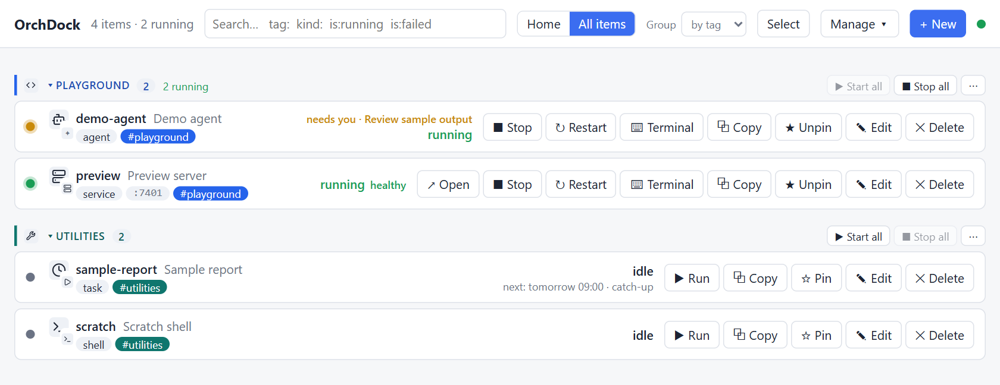

# OrchDock

**Run it. Close the window. Pick up where you left off.**

OrchDock is a local control panel for your dev servers, coding agents,
scheduled tasks, and shells. Start them from one window, see what?s running or
needs you, and reattach from your terminal. Runs keep going when you close
OrchDock.

[Install and start](#install-and-start) ? [User guide](docs/user-guide.md)



**Status: in development.** File formats may still change.

## What it does

- **Find any run.** Pin favorites to Home, group items by project tag, and search
  for running or failed items. Open a run?s output in the window or reattach
  with `orchdock attach <alias>`.
- **Keep services on predictable ports.** Give each service a stable port, see
  whether it answers, and find which process is using a port when there?s a
  conflict.
- **See what needs you.** A failed task or a terminal bell from an agent can
  mark the item in the window and notify you. Schedule recurring commands and
  choose what happens when a run is missed.

OrchDock runs on your machine. No accounts or telemetry.

## Install and start

Build from source:

```sh
go run ./tools/build -out dist     # builds orchdock and orchdockw for this OS, with a size check
```

Unpack the archive, then:

- **Windows, installed:** run `orchdock install` (add `--autostart` to start in
  the tray at sign-in) from the unpacked folder. OrchDock goes to your Programs folder,
  gets a Start-menu entry, its folder joins your PATH (with the short alias
  `odock`) and it appears under Apps, where it can be uninstalled
  (`orchdock uninstall` does the same). Your data is never removed.
- **Windows, portable:** double-click `orchdockw.exe` in the unpacked folder. The
  window opens and the OrchDock icon appears in the notification area; data is
  kept in a `data` folder next to it. Closing the window keeps OrchDock in the
  tray; runs keep going.
- **Any system:** `orchdock ui` opens the window, `orchdock serve` runs the service
  in a terminal, and `orchdock ls` lists your items.

The builds are not signed yet, so Windows SmartScreen may warn on first start.
Size and memory use: [docs/footprint.md](docs/footprint.md).

### Try your first run

In the window, choose **+ New**, add a task with the command
`echo Hello from OrchDock`, then click **Run**. Open the row to see its output.
You can try the same task from the CLI:

```sh
orchdock add task "Hello" --alias hello --cmd "echo Hello from OrchDock"
orchdock run hello --wait
```

## Documentation

- [User guide](docs/user-guide.md): items, kinds, tags, Home, running and
  attaching, services, schedules, attention, import, the tray.
- [Configuration](docs/configuration.md): the data folder, `.env`, settings.
- [FAQ](docs/faq.md).
- [Changelog](CHANGELOG.md).

## Building and testing

Requires Go (version in `go.mod`) and, for the web tests, Node.

```sh
go test ./...                 # all tests, including the privacy check
node --test web/model.test.js # the window's logic
```

`tools/uicheck` drives the window in a real browser; see its README.

## License

MIT, see [LICENSE](LICENSE). The two agent logos in `web/icons/` come from
lobe-icons (MIT); see [web/icons/NOTICE.md](web/icons/NOTICE.md).
