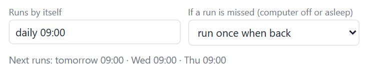

# User guide

[Add an item](#items) ? [Find items from Home](#home-and-sections) ?
[Run and reattach](#running) ? [Manage service ports](#services-and-ports) ?
[Schedule a task](#schedules)

## Items

An **item** is anything you start: a dev server, a task board, a build script,
an AI coding agent, an interactive shell, or a link to a folder or web address.
Every item is just a command (a link is a shortcut), so OrchDock treats them all
the same way: run, stop, restart, look at the output.

Each item has:

- an **alias** (short unique name, used on the command line) and a **title**;
- a **kind**, which decides how it behaves:

  | Kind | Behaves like |
  |---|---|
  | task | a command that finishes; can run on a schedule |
  | service | keeps running; has a port, a health check and a restart policy |
  | agent | an interactive AI coding session (stopped gently) |
  | shell | an interactive terminal |
  | link | opens a folder or address, nothing runs |

- a **command**: a command line run through a shell (`auto`, `pwsh`,
  `powershell`, `cmd`, `bash`, `zsh`, `sh`) or a program with arguments run
  directly (shell `none`), a working folder and environment variables;
- optional **variants**: other ways to run the same item (extra arguments, a
  different line, other variables). The Run button's arrow lists them;
- optional **tags**, **icon** and **notes**, and a **pin** to show it on Home.

Add items with **+ New** in the window, or:

```sh
orchdock add service "Dev server" --alias web --cmd "npm run dev -- --port {port}" --cwd /path/to/shop
orchdock add task "Pull" --cmd "git pull" --cwd /path/to/shop --schedule "daily 09:00" --missed catchup
orchdock add agent "Agent" --cmd "my-agent --continue" --cwd /path/to/shop
orchdock add link "Docs" --target https://example.com/docs
```

`{port}` in a command is replaced by the service's port.

With shell `cmd`, the line reaches cmd.exe exactly as you typed it, as if typed
at a `cmd` prompt: quotes, `&`, `^` and `%VAR%` keep their usual meaning, and
**Copy** gives the same line. The environment lines that the full Copy adds
(`set "NAME=value"`) cannot hold a value with a double quote in it.

## Your own kinds

**Kinds** (button in the window, or `orchdock kind ...`) lets you rename and
recolour the built-in kinds and add your own, such as "MCP server" or "Build".
Your kind has a name, a colour and the built-in kind it behaves like. Deleting a
kind asks where its items go.

## Tags

**Tags** group your items, for example by the project you work on (`shop`), by
purpose (`daily`) or anything else; an item can have several. In **All items**
the list is grouped by tag (switch to *by kind* or *none* at the top): an item
shows under each of its tags, and items without tags come last under
**Untagged**. Each header shows how many items run or failed, and has **Start
all** / **Stop all** and a **⋯** menu.

**Manage ▸ Tags** gives a tag a colour, an icon and optionally a **folder**. A
tag with a folder:

- is **suggested** in the editor for an item whose working folder is inside it
  (click the suggestion to add it; nothing is added by itself);
- gives its items their default working folder and `{projectDir}` when they have
  none of their own, and their icon when the item's icon is set to *main tag*.

An item's **main tag** is its first tag with a folder (or else its first tag
with its own icon). Renaming a tag renames it on every item and in sections;
deleting it either forgets only its settings or also takes it off its items.

```sh
orchdock tag set shop --folder /path/to/shop --color "#4f8cff"
orchdock tag rename shop store
orchdock ls --group tag
```

## Home and sections

**Home** shows the items you **pinned** (☆ on a row, or `orchdock pin <alias>`)
and then your **sections**. A section is a saved search shown as a group, such
as `tag:shop` or `kind:agent is:running`; an item shows in every section it
matches, and a search typed on Home narrows all of them.

- Add a section from a tag header (**⋯ ▸ Show on Home**), or type a search in
  **All items** and click **☆ Save this search as a section**.
- Rename, reorder or remove sections from their header menu or **Manage ▸
  Sections**. Removing a section never changes its items.
- The chips under the top bar open a section's search in **All items**.

Home opens first once you have pinned an item or added a section; the switch at
the top goes between **Home** and **All items** and is remembered.

Catalogs from earlier versions that had *projects* are converted when loaded:
each project becomes a tag with the same folder, colour and icon, its items get
that tag, and a section shows it on Home.

## Running

- **Run** starts the item (the arrow picks a variant). **Stop** ends it gently
  (an interrupt, then a wait, then termination; agents get a gentler sequence).
- A run keeps going when you close the window or quit OrchDock.
- **Terminal** opens the running item in your system terminal. Press **Ctrl+]**
  there to detach; the run keeps going. From any terminal: `orchdock attach <alias>`.
- **Copy** copies the command (with its folder and variables, or just the line)
  to paste elsewhere.
- Clicking a row opens its details: settings, run history (with each run's log)
  and the latest output.

```sh
orchdock run web                 # start
orchdock run build --wait        # run, print the output, exit with its exit code
orchdock logs web --follow
orchdock stop web
orchdock history web
```

## Services and ports

A service keeps one port. Leave the port empty to get one assigned once from the
configured range (default 7401-7499) and kept from then on, or type a fixed
port. Starting a service on a port another program already listens on is
refused, naming that program; OrchDock never moves a service to another port.

A running service shows **starting**, **healthy** (it answers on its port) or
**unhealthy**, and an **Open** button for its address. "If it stops by itself"
can restart it when it fails, backing off between tries and giving up after 5
restarts in 10 minutes. **Ports** lists every service port and who holds it.

## Schedules

To run a task automatically, open its editor and enter a schedule under
**Runs by itself**. The editor previews the next three runs.



Use any of these schedule formats:

| Schedule | Meaning |
|---|---|
| `every 15m`, `every 2h`, `every 1h30m` | repeatedly |
| `daily 09:00` or `daily 09:00,18:30` | every day at those times |
| `weekly mon,thu 09:00` | on those weekdays |
| `monthly 1 08:00` | on that day of the month (31 means the last day) |
| `cron "*/5 * * * *"` | a five-field cron expression |

**If a run is missed** because the computer was off or asleep: *skip it*
(recorded in the history), or *run once when back* (one run for the newest
missed time, never one per missed time, and not if it is older than the
task's limit). A new or changed schedule never runs times from before it
existed. Times follow your local clock, including daylight-saving changes.

On the command line also: `--overlap skip|queue|restart` (what to do when the
previous run still goes) and `--timeout <minutes>`.

Schedules run only while OrchDock runs. When you save your first schedule,
OrchDock offers to start in the tray when you sign in (`orchdock autostart on`).

## Attention

An item asks for you when its run rings the terminal bell (agents do this when
they wait for an answer), when a task fails or times out, or when a script calls:

```sh
orchdock notify build "release build finished"
```

The row shows **needs you** with the reason, the tray icon gets an amber dot, and
a desktop notification appears; clicking it opens the item. Opening the item (or
attaching to it) clears the mark.

## Import

**Import** (or `orchdock import file.json`, add `--dry-run` to preview) adds
tags, items and icons from one JSON file. Existing aliases are skipped and
bad entries are reported without stopping the rest.

```json
{
  "iconFiles": { "shop.png": "/path/to/logo.png" },
  "tags": [
    { "name": "shop", "path": "/path/to/shop", "icon": { "primary": "file:shop.png" } },
    { "name": "temp", "color": "#64748b" }
  ],
  "items": [
    { "alias": "shop-web", "title": "Dev server", "kind": "service", "tags": ["shop"],
      "command": { "line": "npm run dev -- --port {port}", "cwd": "/path/to/shop" },
      "service": { "port": 5173 } }
  ]
}
```

Items use the same fields as OrchDock's own catalog. A port given in the file is
kept fixed. Files from earlier versions with `projects` (and `"project"` on
items) still import: each project becomes a tag with a section.

## The tray

On Windows, OrchDock lives in the notification area. Left-click shows the
window; right-click lists running items (with Stop), **Open OrchDock** and
**Quit** (runs keep going). The icon shows a green badge while something runs
and an amber dot when an item needs you.

## Icons

Every item and tag can have an icon. In the editor, click the icon next to
**Icon** (for a tag, the icon button in **Manage ▸ Tags**) and choose:

- **Built-in**: a set of simple line icons (database, server, rocket, …);
- **Emoji**;
- **Upload**: your own png, jpg, ico or svg image (up to 512 KB; SVG with
  scripts is refused). Uploaded images can be picked again later;
- **Monogram**: one or two letters on a colour;
- **Automatic**: for an item, the icon of its main tag, the agent's logo (from
  its command) or the service's own web icon; for a tag, an image found in its
  folder (favicon, logo …) or its initials.

An item shows a main icon with a small badge in the corner; choose which one you
change at the top of the picker. Running services show their own web icon in the
badge once they answer.

## Organising

- **Search** with `tag:name` (several tags must all match; `tag:none` finds
  untagged items), `kind:`, `is:running`, `is:failed`, `is:idle` and words.
- **Select**: pick several items with the checkboxes, then run, stop, tag,
  untag or delete them together.
- **Trash**: deleting moves an item to the trash for 30 days, with its history.
  **Manage ▸ Trash** restores it. `orchdock rm --permanent` skips the trash.
- **Export**: **Manage ▸ Export…** (or `orchdock export -o file.json`) saves
  tags, kinds, items, sections and icons in the import format, for another machine.
  Environment variable values are left out unless you ask for them
  (`--include-env`); their names are kept.
- **Keyboard**: **Ctrl+K** opens a command palette (run, stop or show any item,
  open any dialog); **/** jumps to the search; **n** adds an item; **Esc** closes.
